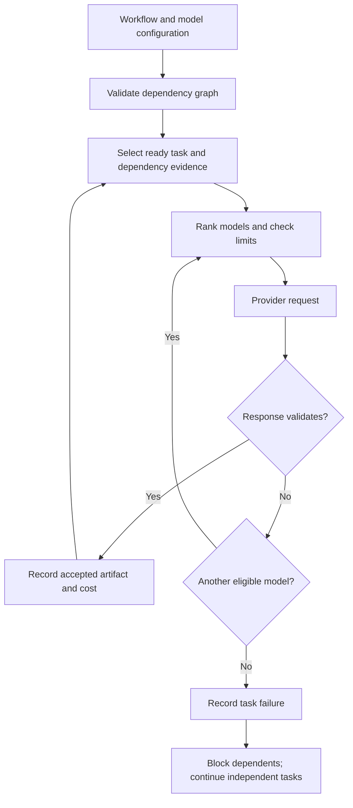

# Adaptive Multi-Agent Orchestration for Cost-Efficient LLM Systems

**Ram Wasankar**  
Engineering case study · Reference implementation v0.1 · 26 October 2026

**Implemented:** model routing, dependency-based agent workflows, verified escalation, bounded retries, selective context handoffs, cost accounting, and an OpenAI-compatible HTTP adapter.  
**Evidence:** executable tests, a 300-task synthetic replay evaluation, ablations, and a 12-task handoff experiment. **Live-model performance has not been measured.**

[Evaluation results](results/offline/RESULTS.md) · [Run the project](docs/USAGE.md) · [Architecture and API](docs/ARCHITECTURE.md) · [Evaluation protocol](docs/EVALUATION.md)

## 1. The engineering problem

A language-model workflow does not have a single notion of “best model.” A low-cost model can be sufficient for extraction but unreliable for a reasoning step. A stronger model can improve a response while adding cost and delay. Dividing work among agents also creates a second source of expense: repeated context, failed intermediate answers, retries, and verification.

This project treats those choices as an execution problem. A workflow declares its tasks, dependencies, validation rules, and spending limit. The orchestrator selects a model, checks the response, escalates when necessary, and passes accepted artifacts to downstream agents. Every attempted call appears in a trace.

The objective is to reduce avoidable work while preserving a measurable definition of task success. The implementation does not assume that a model's confidence is a reliable correctness signal, that all tasks need multiple agents, or that selecting the cheapest model first is always the best latency tradeoff.

## 2. Scope and design decisions

| Decision | Implementation | Reason |
| --- | --- | --- |
| Task decomposition | Explicit dependency graph supplied by the caller | Makes execution and overhead inspectable; no hidden planner calls |
| Model selection | Fixed model, cost-ordered cascade, or calibrated task-family routing | Supports meaningful baselines and a transparent learned policy |
| Acceptance | Caller-supplied validator | Separates execution success from correctness or domain validity |
| Escalation | Try another model after a rejected response | Limits unnecessary strong-model calls when a cheaper answer passes |
| Agent communication | JSON artifacts with producer ID and SHA-256 digest | Preserves provenance across model/provider boundaries |
| Memory | Direct dependency outputs only | Avoids carrying unrelated conversation history |
| Scheduling | Deterministic sequential topological order | Keeps accounting and failure behavior simple and reproducible |
| Inference integration | Configurable Chat Completions endpoints | Supports compatible hosted services and self-hosted inference servers |
| Logging | Metadata and output digests by default | Avoids publishing raw prompts, answers, or credentials in traces |

Each task is a separately prompted agent role. This version does not implement autonomous agent spawning, tool execution, a parallel scheduler, a vector database, or a trained semantic router. Those are possible extensions, not capabilities implied by the project title.

## 3. System architecture

The executor first rejects missing dependencies, duplicate task identifiers, and cycles. Ready tasks run in a stable order. A child receives only artifacts from successfully completed dependencies. A failed parent blocks dependent work; independent tasks can continue unless budget uncertainty has halted the entire run.

The provider interface returns text, input/output usage, a latency value, and whether usage was estimated. The live HTTP adapter measures request latency and uses reported token usage when available. It does not expose API keys in configuration files or traces; keys are read from explicitly named environment variables. Redirects are refused to avoid forwarding authentication to another destination.

## 4. Routing and escalation

The calibrated policy learns a compact table from a separate calibration split. For task family \(k\) and model \(m\), it estimates success using additive smoothing:

\[
\hat p_{k,m}=\frac{s_{k,m}+1}{n_{k,m}+2}.
\]

The policy ranks the least expensive model whose estimated success meets a configurable threshold \(\tau\) first. When no model meets the threshold, it ranks an explicit fallback first; an unknown task family uses only that fallback. Remaining models are ordered by estimated success, then estimated cost. The executor walks this ranking, skipping models that cannot fit the estimated context or remaining budget. Admission can therefore change which model receives the first actual call.

This is a task-family contextual lookup policy. It does not claim contextual-bandit learning, neural routing, calibrated confidence bounds, or optimal model selection. The threshold controls the initial choice; fallback attempts can include models below it. The observed quality of the completed task depends on the entire cascade and the validator.

The executor stops on the first accepted output. Fixed-model baselines get one model attempt; cascaded policies can spend additional calls. Results therefore report call counts and cumulative cost, rather than comparing only final answers.

## 5. Cost accounting and failure behavior

With model-specific input and output rates, estimated request cost is:

\[
\widehat C_m=\frac{\widehat T_{in}r_{in,m}+T_{out,max}r_{out,m}}{10^6}.
\]

The executor performs preflight admission using this estimate, then reconciles the ledger with returned usage. It counts rejected responses as paid work. Models that cannot fit the estimated remaining budget or context window are skipped.

The input estimate is byte-based, not a model-specific tokenizer. This intentionally errs toward rejecting large requests, but it is not a universal billing bound. If reported usage exceeds the remaining budget, the run records a budget overrun and halts subsequent calls. If usage is absent, the ledger explicitly marks the charge as estimated.

A timeout or malformed successful response creates uncertainty: the upstream service may have processed and billed the request. The system records the reservation as provisional spend and stops the workflow. It retries explicit rate-limit rejections with bounded exponential backoff, under the documented assumption that those rejected requests are not billed. Provider-specific billing rules still need verification before deployment.

Cost rates in the examples and offline experiment are illustrative. A real deployment must include API pricing or an internally defined GPU cost model. Token rates alone do not capture idle GPU time, model loading, batching utilization, or external verifier charges.

## 6. Context handoffs

Accepted outputs become named artifacts. A receiving task specifies its dependencies and receives a JSON list containing the producer ID, output, and content digest. Artifacts are labeled as untrusted data in the prompt; this is not a complete prompt-injection defense.

The implementation removes unrelated history but preserves the complete requested artifacts. If dependency evidence exceeds the context budget, it rejects the task instead of silently truncating evidence. This makes the failure visible and avoids implying that discarded details are harmless.

In a separate structural experiment, 12 scripted agents form two interleaved six-step chains. Direct-dependency handoffs transmit **12,230 context characters**, versus **80,765** when every prior artifact is replayed: **84.86% less context**. Both executions pass scripted dependency checks. This measures graph-based context selection, not semantic compression or retained accuracy on real LLM reasoning tasks.

## 7. Evaluation design

The checked-in evaluation uses **240 calibration tasks** and **300 disjoint test tasks**, balanced across extraction, arithmetic, and short reasoning. A seeded generator produces prompts, exact answers, and scripted provider responses. Model success probabilities, token rates, and service delays are explicit experimental inputs.

All policies see the same test tasks and the same model responses. Routing is fitted on the calibration split and frozen before testing. Expected answers are available to the evaluator and verifier, not serialized into provider requests. The initial study assumes an ideal exact-match verifier. This is a controlled execution experiment, not a benchmark of language-model intelligence.

The four policies are always-small, always-large, cheap-first cascade, and calibrated routing. Metrics include accepted exact matches, total modeled spend, modeled cost per success, number of calls, token counts, and modeled p50/p95 latency. Python replay time is recorded separately and is never presented as inference latency.

The report includes Wilson intervals for task success and a paired bootstrap interval for cost savings. These intervals describe variation within the constructed workload; they do not justify deployment claims or generalization to other models.

## 8. Results and tradeoffs

| Policy | Correct / 300 | Calls | Simulated cost units | Modeled p95 |
| --- | ---: | ---: | ---: | ---: |
| Always small | 157 | 300 | 0.0017965 | 80 ms |
| Always large | 291 | 300 | 0.0269475 | 450 ms |
| Cheap-first cascade | 299 | 474 | 0.0083838 | 710 ms |
| Calibrated routing | 299 | 322 | 0.0137054 | 450 ms |

**The calibrated policy reduces simulated cost by 49.14% relative to always-large in this fixture.** Its paired bootstrap interval is 44.06%–53.92%. It uses 322 calls rather than the cascade's 474 and avoids the cascade's higher modeled tail latency.

**The cheap-first cascade is cheaper.** At equal fixture success, it spends about 38.8% less than calibrated routing. The calibrated policy is useful when avoiding extra calls and tail delay matters enough to justify that difference. There is no single winning policy across all objectives.

Removing escalation from calibrated routing reduces correctness to 280/300. Raising its initial quality threshold to 0.95 restores 299/300 after escalation but increases simulated spend to 0.0193044. The threshold is therefore an operating choice, not a free reliability improvement.

### The verifier changes the answer

With an injected imperfect verifier, calibrated routing accepts 285 answers but only 284 are correct. Cheap-first also accepts 285, of which 274 are correct. A dashboard that reports accepted tasks as correctness would hide 1 and 11 false accepts respectively. The control uses assumed error rates and deterministic verdicts, so its exact numbers are illustrative; the engineering lesson is to evaluate the verifier independently.

### Budget admission can be conservative

At a 0.00002-unit per-task budget, every task is rejected before inference. At 0.0001 units, the available calls effectively collapse toward the small model and correctness is 157/300. At 0.001 units, the calibrated run again reaches 299/300. Estimated reservation can deny a request whose actual short response would have fit. Provider tokenizers and tighter output predictions would improve admission efficiency.

The full data, assumptions, per-family breakdowns, raw traces, and ablations are in [recorded results](results/offline/RESULTS.md).

## 9. Outcomes

The delivered outcome is a working, inspectable orchestration reference implementation with separate policy, provider, context, validator, and execution modules. It can run offline without credentials, and it has an opt-in path for configured live inference endpoints.

The software tests cover dependency validation, selective evidence, failed-parent behavior, escalation across providers, bounded rate-limit retries, uncertain billing, actual usage overruns, malformed responses, credential-safe redirects, and missing token usage. These establish specific implementation behaviors rather than broad production readiness.

The experiments establish three conditional findings: context need not grow with all prior agents, cheap-first cascades can minimize spend at the expense of additional calls, and acceptance metrics are only as trustworthy as the verifier. No result in this repository should be described as a measured saving on OpenAI, a particular open-source model, or a production deployment.

## 10. Remaining work before a real-model performance claim

1. Configure actual model IDs, compatible endpoints, context limits, prices, and inference hardware. Record versions and sampling settings.
2. Collect calibration data from those models; replace the synthetic success table.
3. Evaluate on held-out, task-appropriate datasets with independent grading and contamination checks.
4. Measure real inference time, queueing, retries, judge costs, and GPU utilization where relevant.
5. Repeat across seeds and workload shifts; test correlated model failures and low-confidence validators.
6. Evaluate parallel scheduling, model-specific tokenization, durable artifact storage, and learned semantic routing as separate changes.

## References

- Chen, Zaharia, and Zou. [FrugalGPT: How to Use Large Language Models While Reducing Cost and Improving Performance](https://arxiv.org/abs/2305.05176). Relevant prior work on cascaded model use; this implementation is not a reproduction of its learning algorithm.
- Ong et al. [RouteLLM: Learning to Route LLMs with Preference Data](https://arxiv.org/abs/2406.18665). Relevant prior work on learned routing; the present router uses a simpler task-family calibration table.
- vLLM. [OpenAI-compatible serving documentation](https://docs.vllm.ai/en/latest/serving/openai_compatible_server/). Protocol reference for connecting self-hosted models. Compatibility with particular live models remains to be tested.
