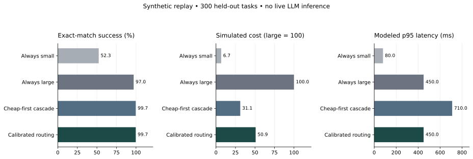

# Recorded evaluation results

**Evidence level: synthetic replay and local software tests. No live model calls were made.**

The success rates below measure agreement with fixture answers. Costs use illustrative token rates; latency uses fixed provider delays. They are not measured API savings, paid invoices, or live-model speed measurements.



| Policy | Success | Simulated cost units | Cost / success | Calls | Modeled p95 |
| --- | ---: | ---: | ---: | ---: | ---: |
| Always small | 157/300 (52.33%) | 0.0017965 | 0.0000114 | 300 | 80 ms |
| Always large | 291/300 (97.00%) | 0.0269475 | 0.0000926 | 300 | 450 ms |
| Cheap-first cascade | 299/300 (99.67%) | 0.0083838 | 0.0000280 | 474 | 710 ms |
| Calibrated routing | 299/300 (99.67%) | 0.0137054 | 0.0000458 | 322 | 450 ms |

## Interpretation

- Calibrated routing uses 49.14% less simulated cost than always-large. The paired 2,000-resample bootstrap interval is 44.06%–53.92%, conditional on this artificial dataset and cost model.
- Cheap-first is cheaper than calibrated routing. Calibrated routing pays more to avoid many failed first attempts and reduce the modeled p95 from 710 ms to 450 ms.
- Both cascaded policies reach 299/300 with a perfect exact-match verifier. This does not demonstrate equivalent performance with a real-world verifier.
- Offline execution time in summary.json is measured Python replay time, not model inference latency.

## Controlled changes

| Scenario | Accepted | Ground-truth correct | False accepts | Calls | Simulated cost |
| --- | ---: | ---: | ---: | ---: | ---: |
| calibrated_no_escalation | 280 | 280 | 0 | 300 | 0.0127775 |
| calibrated_target_095 | 299 | 299 | 0 | 318 | 0.0193044 |
| calibrated_imperfect_verifier | 285 | 284 | 1 | 349 | 0.0146929 |
| cascade_imperfect_verifier | 285 | 274 | 11 | 481 | 0.0091148 |
| budget_0.00002 | 0 | 0 | 0 | 0 | 0.0000000 |
| budget_0.0001 | 157 | 157 | 0 | 300 | 0.0017965 |
| budget_0.001 | 299 | 299 | 0 | 322 | 0.0137054 |

The imperfect-verifier control injects a 10% false-positive probability and a 5% false-negative probability using a deterministic hash of task ID and output. These rates are experimental assumptions, not measured verifier performance. Identical answers receive correlated verdicts. Budget cases use conservative preflight estimates; a task may be skipped even when its realized short response would have fit.

## Dependency handoff control

Two interleaved six-step chains execute 12 scripted agent tasks. Direct-dependency handoffs send 12,230 characters versus 80,765 for full history: a 84.86% reduction. Both workflows pass their scripted evidence checks. Estimated input tokens are 3,788 versus 20,927. This is structural context elimination, not semantic compression or demonstrated LLM quality retention.

## Reproduction and evidence

```bash
python -m evaluation.run
python -m evaluation.context_study
python -m evaluation.sensitivity
python -m evaluation.report
```

The final plotting command requires matplotlib. The engine, tests, and numerical experiments use the Python standard library.

- Seed: `20261026`; calibration: 240 tasks; held-out: 300 tasks.
- Python: `3.12.14`.
- Code digest: `0f980a3cbaab4fa88f2cecd3398d10c5288ff820083d732d071aa260bf66865d`.
- Calibration fixture digest: `225c48f5a9b2630fc28fcf6d844a082a8ec47a6795175d08b063d5001dc6faad`.
- Test fixture digest: `6ab6b9b819e87514ab27e6c0c7a895742879eac3e9c0c9e7bfce7cacc706495a`.

Files: [summary.json](summary.json), [summary.csv](summary.csv), [raw traces](traces.jsonl), [calibration](calibration.json), [test fixtures](test_fixtures.jsonl), [sensitivity](sensitivity.json), [sensitivity traces](sensitivity_traces.jsonl), [context control](context_study.json). Wall-clock measurements vary between runs; deterministic outcomes and simulated totals should reproduce.
